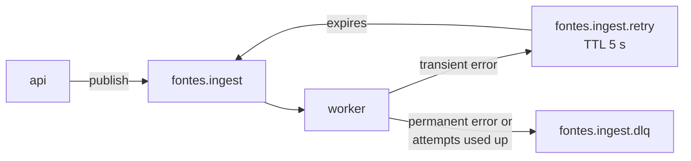

# Fontes

[](https://github.com/sibprojects/fontes/actions/workflows/ci.yml)

> *Fontes* is Latin for "sources".

Fontes answers questions about your own documents, and every answer cites its sources. You upload PDFs or other docs, ask a question, and each claim in the answer links back to the document and page it came from.

**Stack:** FastAPI · PostgreSQL + pgvector · RabbitMQ · Ollama (local LLM) or Claude · React

🚧 Work in progress.

## Run locally

You need Docker with Compose.

```bash
docker compose up --build
```

The first start downloads two models into the `ollama` volume, about 6 GB in total: the embedding model `bge-m3` (about 1.2 GB) and the chat model `qwen2.5:7b` (about 4.7 GB). That takes a while; the worker starts once they are there, and later starts reuse the volume. On a smaller machine pick a smaller chat model, for example `CHAT_MODEL=qwen2.5:3b docker compose up --build` (or `qwen2.5:1.5b`); answers get weaker as the model shrinks. Answering also needs memory for the model: about 6 GB for `qwen2.5:7b`.

With an NVIDIA GPU, add the GPU overlay so Ollama runs on it (Docker Desktop on Windows supports this out of the box; Linux needs the NVIDIA Container Toolkit):

```bash
docker compose -f docker-compose.yml -f docker-compose.gpu.yml up --build
```

`qwen2.5:7b` fits in 8 GB of video memory. On a GPU an answer takes a second or two; on CPU, about a minute.

To check that it works, run:

```bash
curl localhost:8000/health
# {"status":"ok","checks":{"database":"ok","rabbitmq":"ok"}}
```

| Service | URL |
|---|---|
| API | http://localhost:8000 (OpenAPI docs at `/docs`) |
| RabbitMQ management | http://localhost:15672 (login `fontes` / `fontes`) |
| Ollama | http://localhost:11434 (local embeddings and chat) |
| Worker | no port: consumes the ingest queue (`docker compose logs -f worker`) |

Database migrations run automatically: the one-shot `migrate` service applies them before `api` and `worker` start.

## API

| Method | Path | What it does |
|---|---|---|
| `POST` | `/documents` | Upload a file (multipart field `file`): `.pdf`, `.md`, `.markdown`, `.html`, `.htm`, up to 20 MiB |
| `POST` | `/documents/url` | Add a web page by URL: `{"url": "https://..."}` |
| `GET` | `/documents` | List documents, newest first |
| `GET` | `/documents/{id}/chunks` | The document's chunks in order: `[{"ordinal", "location", "text"}]` (empty until it is `ready`) |
| `DELETE` | `/documents/{id}` | Delete a document, its stored file and its chunks |
| `POST` | `/ask` | Ask a question: `{"question": "..."}`; the answer streams back as Server-Sent Events (see [Ask](#ask)) |
| `GET` | `/questions` | The 50 latest questions, newest first: `[{"id", "question", "label", "created_at"}]` |
| `GET` | `/questions/{id}` | One question with its full answer, paragraphs and citations |

A new document is `201 Created`. Uploading the same content again, or adding the same URL, returns the existing document with `200 OK`. Errors come back as `{"detail": "..."}` with `400` (empty file), `413` (too large), `415` (unsupported type), `422` (invalid URL) or `404` (unknown id).

```bash
curl -F file=@notes.md localhost:8000/documents
curl -H 'content-type: application/json' -d '{"url":"https://example.com"}' localhost:8000/documents/url
curl localhost:8000/documents
curl localhost:8000/documents/<id>/chunks
curl -X DELETE localhost:8000/documents/<id>
```

A new document starts as `queued` and the worker takes it to `ready`; see [How ingestion works](#how-ingestion-works).

## Ask

`POST /ask` answers from the `ready` documents only. It finds the chunks closest to the question (cosine similarity of `bge-m3` vectors), hands them to the chat model as numbered sources, and streams the answer:

```bash
curl -N -H 'content-type: application/json' -d '{"question":"How do I install it?"}' localhost:8000/ask
```

```text
event: token
data: {"text": "Run `make install`"}

event: token
data: {"text": " [1]."}

event: verdict
data: {"question_id": "…", "label": "supported", "paragraphs": [{"text": "Run `make install` [1].", "supported": true, "citations": [1]}], "citations": [{"n": 1, "document_id": "…", "document_title": "guide.md", "location": "Install", "url": null, "excerpt": "…"}]}
```

- **`token`** events carry the answer as the model writes it. This text is provisional.
- **`verdict`** comes once, at the end. It holds the verified answer, which is what is stored in the history. Show this one.
- **`error`** (`{"detail": "..."}`) replaces the verdict if anything fails mid-way, for example `Cannot reach Ollama at http://ollama:11434`. A failed question is not stored.

A blank question, or one over 2000 characters, is rejected with `422` before any streaming.

**How verification works.** The model is told to put a source marker such as `[1]` or `[2][3]` in every paragraph and list item. After the answer is complete, Fontes splits it into paragraphs (blank-line separated) and list items, and checks each marker:

- **Valid markers.** A marker that names one of the sources given to the model is kept. A group like `[2, 1]` is rewritten as `[2][1]`.
- **Invalid markers.** A marker that names a source the model never saw, such as `[9]` when there were 6 sources, is removed from the text.
- **Paragraphs.** A paragraph is `supported` if at least one valid marker is left in it.
- **Code.** Brackets inside code (`` `arr[0]` `` or a fenced block) and indexes such as `a[2]` are not markers: they are left as they are and never count as citations.

| Label | Meaning |
|---|---|
| `supported` | Every paragraph cites a real source |
| `partially_supported` | Some paragraphs do, some don't |
| `unsupported` | No paragraph does |
| `not_found` | Nothing relevant was found, so the model was not asked |

Verification checks that each claim *points at* a source, not that the source says it. The source excerpt is in the verdict's `citations`, so a reader can check.

**Not found.** If no chunk scores at least `ASK_MIN_SCORE`, the model is not called at all. The answer is "I could not find anything about this in your documents." with the label `not_found`, and it is stored in the history like any other answer.

**History** keeps a snapshot of each cited source (title, location, excerpt), so old answers still show their sources after the document is deleted.

Ask settings: `CHAT_MODEL` (`qwen2.5:7b`), `LLM_TIMEOUT_SECONDS` (300.0), `LLM_NUM_CTX` (8192: the model's context window, always sent, because Ollama's default would silently cut off the sources), `LLM_TEMPERATURE` (0.1), `LLM_MAX_TOKENS` (1024: the longest answer; a longer one ends with an `error` event saying it was cut off), `ASK_TOP_K` (6: how many chunks are given to the model), `QUESTION_MAX_CHARS` (2000), and `ASK_MIN_SCORE` (0.45). `ASK_MIN_SCORE` is a cosine similarity threshold and is worth tuning on your own documents: raise it if unrelated questions get answered, lower it if real questions come back `not_found`. Under Compose these settings are passed to the `api` service, so set them in the shell or in a `.env` file next to `docker-compose.yml`, for example `ASK_MIN_SCORE=0.35 docker compose up -d api`.

## How ingestion works

Adding a document saves it as `queued` and publishes `{"document_id": "..."}` to RabbitMQ. The `worker` service consumes it, marks the document `processing`, processes it and marks it `ready`. The Postgres row is the source of truth for status; RabbitMQ only carries the work.

Processing means: extract the text, split it into chunks of up to about 1500 characters (with a 200-character overlap), embed each chunk with Ollama, and store the chunks and their vectors in Postgres (pgvector). A rerun replaces a document's chunks, so a retry never leaves duplicates.

| Format | How a chunk is cited |
|---|---|
| PDF (`.pdf`) | page: `p. 4`, or `pp. 4–5` for a chunk that spans two pages |
| Markdown (`.md`, `.markdown`) | the nearest heading above it |
| HTML (`.html`, `.htm`) and web pages (by URL) | the nearest heading above it |

When there is no heading, the chunk is cited by position: `part 3 of 12`. Web pages are fetched by the worker (HTML only, up to 20 MiB, up to 5 redirects).



- **Ack after the work.** A message is acked only after the document's new status is written, or after its retry or DLQ copy is confirmed by the broker. If the worker dies mid-way, RabbitMQ redelivers the message.
- **Retries.** A transient failure (say, a service is unreachable) puts the document back to `queued` and sends the message to `fontes.ingest.retry`. After a fixed 5 s TTL it flows back into the main queue. Attempts are counted in Postgres; after 3 the document is `failed` with the error stored, and the message goes to the DLQ with the error in the `x-fontes-error` header.
- **Permanent or transient.** A corrupt or password-protected PDF, a file with no extractable text, an unsupported content type or an HTTP 4xx from a URL is permanent: the document is `failed` at once. Ollama or Postgres being unreachable, a network error, or an HTTP 408, 429 or 5xx is transient and retried; the stored error says which service failed (for example `Cannot reach Ollama at http://ollama:11434`).
- **No loops.** A permanent failure (a corrupt file) goes to the DLQ at once. A message that cannot be decoded (not JSON, or nested too deeply to parse) goes straight to the DLQ. If the handler raises unexpectedly (say, Postgres is down), the message is retried with a crash count in the `x-fontes-crashes` header and goes to the DLQ on the 4th crash. If the worker process dies outright, RabbitMQ redelivers the message; every delivery counts as an attempt, and once 3 are used up the next delivery marks the document `failed` ("Gave up after 3 attempts") without processing it again.
- **Idempotent.** A redelivered or duplicate message for a `ready` or `failed` document does nothing; one for a deleted document is dropped.
- **Broker down or stalled at upload time.** The upload still succeeds (publishing gives up after 3 s) and the document stays `queued`.
- **Recovery sweep.** On startup the worker republishes every `queued` and `processing` document, so a message lost with the broker or the previous worker, or dead-lettered while the database was down, is picked up again. RabbitMQ keeps its data in a volume, so queued messages also survive `docker compose down`.

To watch it, open the management UI at http://localhost:15672 → **Queues**: the three `fontes.ingest*` queues, their message rates, and (via **Get messages** on the DLQ) the failed messages with their error headers. `docker compose logs -f worker` shows each outcome.

Settings (environment variables): `INGEST_MAX_ATTEMPTS` (3), `INGEST_RETRY_DELAY_MS` (5000), `WORKER_PREFETCH` (1), `PUBLISH_TIMEOUT_SECONDS` (3.0). The retry delay is a queue argument: after changing it, delete `fontes.ingest.retry` so it is declared again.

Ingestion settings: `OLLAMA_URL` (`http://localhost:11434`; `http://ollama:11434` in Compose), `EMBEDDING_MODEL` (`bge-m3`), `EMBEDDING_DIMENSION` (1024), `EMBED_BATCH_SIZE` (16), `OLLAMA_TIMEOUT_SECONDS` (120.0), `URL_FETCH_TIMEOUT_SECONDS` (20.0, per network operation), `URL_FETCH_DEADLINE_SECONDS` (60.0, for the whole fetch), `CHUNK_MAX_CHARS` (1500), `CHUNK_OVERLAP_CHARS` (200), `CHUNK_MIN_CHARS` (300).

### Changing the embedding model

The vector dimension is fixed by the database migration (`vector(1024)` for `bge-m3`). To use another model:

1. Set `EMBEDDING_MODEL` and `EMBEDDING_DIMENSION`, and change the model in the `ollama-pull` service in `docker-compose.yml`.
2. Add an Alembic migration that changes the `chunks.embedding` column (and its HNSW index) to the new dimension.
3. Upload the documents again. Vectors from different models cannot be compared, and there is no re-index tool.

### Known limits

- **Scanned PDFs** (images with no text layer) are rejected with "No text could be extracted"; there is no OCR. DOCX is not supported.
- **Private addresses.** A URL whose host resolves to a private, loopback or link-local address is refused, at every redirect. DNS rebinding (a host that resolves differently between the check and the fetch) is not defended against; acceptable for a local, single-user app.
- **Long documents on CPU.** RabbitMQ's default consumer timeout is 30 minutes: a document that takes longer to embed is redelivered and counts another attempt.
- **Answer speed on CPU.** Without a GPU, `qwen2.5:7b` writes a few tokens per second, and the first question also loads the model into memory. A full answer can take a minute or more. A smaller `CHAT_MODEL` is faster.
- **Each question stands alone.** There is no conversation: a follow-up such as "and the second one?" does not see the previous question.

## Why not Celery

- **The stack is async end to end.** FastAPI, SQLAlchemy and `aio-pika` all run on one asyncio event loop. Celery's workers are synchronous at heart, so async code would need a bridge in every task.
- **The queue topology is explicit on purpose.** Queues, the TTL-based retry queue, the dead-letter queue and the ack rules are written out in `backend/fontes/adapters/messaging/` and can be read in one sitting. A framework would hide exactly the part this project means to show.

## Development

The backend lives in `backend/` and is managed with [uv](https://docs.astral.sh/uv/):

```bash
cd backend
uv sync
cp .env.example .env            # optional: override DATABASE_URL / RABBITMQ_URL

uv run pytest                  # unit tests
uv run ruff check .            # lint
uv run ruff format --check .   # formatting
uv run mypy fontes tests       # type check (strict)
```

The integration tests need real Postgres and RabbitMQ. Start them first, then run the tests:

```bash
docker compose up -d postgres rabbitmq
cd backend && uv run pytest -m integration
```

CI runs all of the above on every push and pull request to `main`. A second job then builds the image, starts the whole stack with Compose and runs `scripts/smoke.sh`, which uploads a file, waits for it to become `ready` with real Ollama embeddings (the job pulls `bge-m3`), checks that its chunks are stored, then asks one question through `POST /ask` and checks that it ends with a verdict and lands in the history. CI uses the small `qwen2.5:0.5b` chat model: it checks the wiring, not the quality of answers. You can run the same check against your local stack:

```bash
scripts/smoke.sh   # or: scripts/smoke.sh http://host:8000
```
