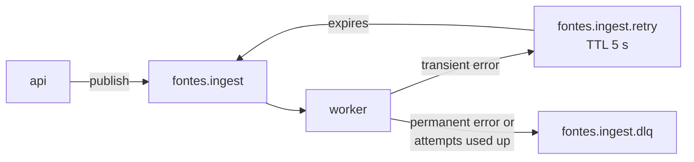

# Fontes

[](https://github.com/sibprojects/fontes/actions/workflows/ci.yml)

> *Fontes* is Latin for "sources".

Fontes answers questions about your own documents, and every answer cites its sources. You upload PDFs or other docs, ask a question, and each claim in the answer links back to the document and page it came from.

**Stack:** FastAPI · PostgreSQL + pgvector · RabbitMQ · Ollama (local LLM) or Claude · React

🚧 Work in progress.

## Run locally

You need Docker with Compose.

```bash
docker compose up --build
```

To check that it works, run:

```bash
curl localhost:8000/health
# {"status":"ok","checks":{"database":"ok","rabbitmq":"ok"}}
```

| Service | URL |
|---|---|
| API | http://localhost:8000 (OpenAPI docs at `/docs`) |
| RabbitMQ management | http://localhost:15672 (login `fontes` / `fontes`) |
| Worker | no port: consumes the ingest queue (`docker compose logs -f worker`) |

Database migrations run automatically: the one-shot `migrate` service applies them before `api` and `worker` start.

## API

| Method | Path | What it does |
|---|---|---|
| `POST` | `/documents` | Upload a file (multipart field `file`): `.pdf`, `.md`, `.markdown`, `.html`, `.htm`, up to 20 MiB |
| `POST` | `/documents/url` | Add a web page by URL: `{"url": "https://..."}` |
| `GET` | `/documents` | List documents, newest first |
| `DELETE` | `/documents/{id}` | Delete a document and its stored file |

A new document is `201 Created`. Uploading the same content again, or adding the same URL, returns the existing document with `200 OK`. Errors come back as `{"detail": "..."}` with `400` (empty file), `413` (too large), `415` (unsupported type), `422` (invalid URL) or `404` (unknown id).

```bash
curl -F file=@notes.md localhost:8000/documents
curl -H 'content-type: application/json' -d '{"url":"https://example.com"}' localhost:8000/documents/url
curl localhost:8000/documents
curl -X DELETE localhost:8000/documents/<id>
```

A new document starts as `queued` and the worker takes it to `ready`; see [How ingestion works](#how-ingestion-works).

## How ingestion works

Adding a document saves it as `queued` and publishes `{"document_id": "..."}` to RabbitMQ. The `worker` service consumes it, marks the document `processing`, processes it and marks it `ready`. Processing is a stub for now (it waits one second); parsing, chunking and embeddings arrive in the next milestone. The Postgres row is the source of truth for status; RabbitMQ only carries the work.



- **Ack after the work.** A message is acked only after the document's new status is written, or after its retry or DLQ copy is confirmed by the broker. If the worker dies mid-way, RabbitMQ redelivers the message.
- **Retries.** A transient failure (say, a service is unreachable) puts the document back to `queued` and sends the message to `fontes.ingest.retry`. After a fixed 5 s TTL it flows back into the main queue. Attempts are counted in Postgres; after 3 the document is `failed` with the error stored, and the message goes to the DLQ with the error in the `x-fontes-error` header.
- **No loops.** A permanent failure (a corrupt file) goes to the DLQ at once. A message that cannot be decoded (not JSON, or nested too deeply to parse) goes straight to the DLQ. If the handler raises unexpectedly (say, Postgres is down), the message is retried with a crash count in the `x-fontes-crashes` header and goes to the DLQ on the 4th crash. If the worker process dies outright, RabbitMQ redelivers the message; every delivery counts as an attempt, and once 3 are used up the next delivery marks the document `failed` ("Gave up after 3 attempts") without processing it again.
- **Idempotent.** A redelivered or duplicate message for a `ready` or `failed` document does nothing; one for a deleted document is dropped.
- **Broker down or stalled at upload time.** The upload still succeeds (publishing gives up after 3 s) and the document stays `queued`.
- **Recovery sweep.** On startup the worker republishes every `queued` and `processing` document, so a message lost with the broker or the previous worker, or dead-lettered while the database was down, is picked up again. RabbitMQ keeps its data in a volume, so queued messages also survive `docker compose down`.

To watch it, open the management UI at http://localhost:15672 → **Queues**: the three `fontes.ingest*` queues, their message rates, and (via **Get messages** on the DLQ) the failed messages with their error headers. `docker compose logs -f worker` shows each outcome.

Settings (environment variables): `INGEST_MAX_ATTEMPTS` (3), `INGEST_RETRY_DELAY_MS` (5000), `WORKER_PREFETCH` (1), `PUBLISH_TIMEOUT_SECONDS` (3.0). The retry delay is a queue argument: after changing it, delete `fontes.ingest.retry` so it is declared again.

## Why not Celery

- **The stack is async end to end.** FastAPI, SQLAlchemy and `aio-pika` all run on one asyncio event loop. Celery's workers are synchronous at heart, so async code would need a bridge in every task.
- **The queue topology is explicit on purpose.** Queues, the TTL-based retry queue, the dead-letter queue and the ack rules are written out in `backend/fontes/adapters/messaging/` and can be read in one sitting. A framework would hide exactly the part this project means to show.

## Development

The backend lives in `backend/` and is managed with [uv](https://docs.astral.sh/uv/):

```bash
cd backend
uv sync
cp .env.example .env            # optional: override DATABASE_URL / RABBITMQ_URL

uv run pytest                  # unit tests
uv run ruff check .            # lint
uv run ruff format --check .   # formatting
uv run mypy fontes tests       # type check (strict)
```

The integration tests need real Postgres and RabbitMQ. Start them first, then run the tests:

```bash
docker compose up -d postgres rabbitmq
cd backend && uv run pytest -m integration
```

CI runs all of the above on every push and pull request to `main`. A second job then builds the image, starts the whole stack with Compose and runs `scripts/smoke.sh`, which uploads a file and waits for it to become `ready`. You can run the same check against your local stack:

```bash
scripts/smoke.sh   # or: scripts/smoke.sh http://host:8000
```
